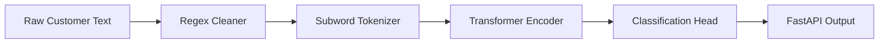

# Sentiment Analysis & Customer Review Intelligence


A transformer-based NLP service that processes customer reviews, extracts sentiment polarity, and returns probabilistic confidence scores.

## Architecture


## Quick Start
```bash
pip install -r requirements.txt
uvicorn src.service.api:app --reload
```
